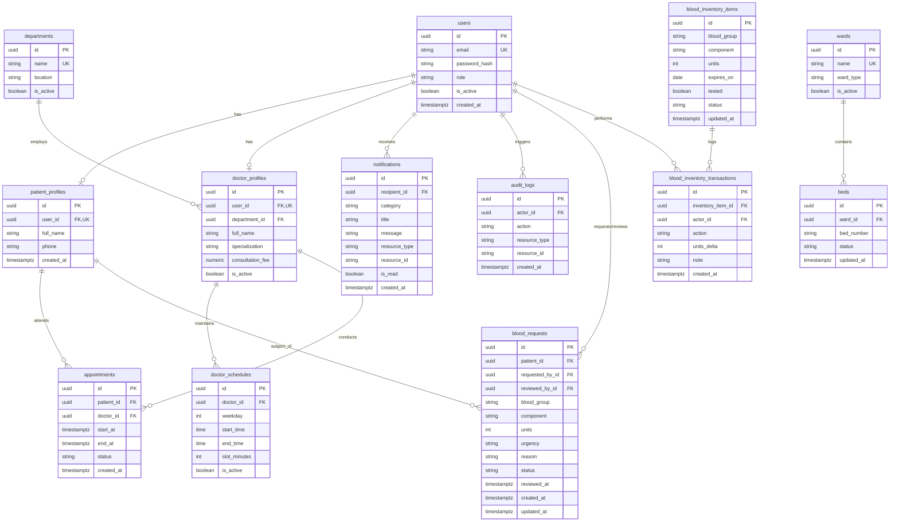

# Medinex AI — Database Entity-Relationship (ER) Specification
**Database:** PostgreSQL 16+ (Hosted on Neon)  
**ORM:** SQLAlchemy 2.0  
**Migration Tool:** Alembic  

---

## 1. Entity-Relationship Diagram (Mermaid)

---

## 2. Table Dictionaries & Constraint Details

### Table: `users`
| Column | Type | Constraints | Description |
| :--- | :--- | :--- | :--- |
| `id` | UUID | PRIMARY KEY | Unique account identifier. |
| `email` | VARCHAR(320) | UNIQUE, NOT NULL, INDEX | Login email address. |
| `password_hash` | VARCHAR(255) | NOT NULL | Argon2id secure hash. |
| `role` | VARCHAR(24) | NOT NULL, CHECK(`ck_users_role`) | Role in ('patient', 'doctor', 'admin', 'receptionist', 'nurse'). |
| `is_active` | BOOLEAN | NOT NULL, DEFAULT true | Account status. |
| `created_at` | TIMESTAMPTZ | NOT NULL | UTC creation timestamp. |

---

### Table: `appointments`
| Column | Type | Constraints | Description |
| :--- | :--- | :--- | :--- |
| `id` | UUID | PRIMARY KEY | Unique appointment ID. |
| `patient_id` | UUID | FK -> `patient_profiles.id`, NOT NULL | Target patient. |
| `doctor_id` | UUID | FK -> `doctor_profiles.id`, NOT NULL | Target doctor. |
| `start_at` | TIMESTAMPTZ | NOT NULL | UTC appointment start time. |
| `end_at` | TIMESTAMPTZ | NOT NULL | UTC appointment end time. |
| `status` | VARCHAR(24) | NOT NULL, CHECK(`ck_appointments_status`) | in ('pending', 'confirmed', 'completed', 'cancelled'). |
| `created_at` | TIMESTAMPTZ | NOT NULL | UTC booking timestamp. |

**Indexes & Concurrency Protection:**
- `uq_appointments_active_doctor_slot`: UNIQUE(`doctor_id`, `start_at`) WHERE `status <> 'cancelled'` — **Guarantees no two patients can book the same doctor slot concurrently.**

---

### Table: `blood_inventory_items`
| Column | Type | Constraints | Description |
| :--- | :--- | :--- | :--- |
| `id` | UUID | PRIMARY KEY | Unique batch identifier. |
| `blood_group` | VARCHAR(3) | NOT NULL, INDEX | A+, A-, B+, B-, AB+, AB-, O+, O-. |
| `component` | VARCHAR(24) | NOT NULL, CHECK(`ck_blood_component`) | in ('red_cells', 'platelets', 'plasma', 'whole_blood'). |
| `units` | INTEGER | NOT NULL, CHECK(`units >= 0`) | Available unit count (never negative). |
| `expires_on` | DATE | NOT NULL | Batch expiration date. |
| `tested` | BOOLEAN | NOT NULL, DEFAULT false | Whether testing has passed. |
| `status` | VARCHAR(24) | NOT NULL, CHECK(`ck_blood_status`) | in ('available', 'reserved', 'issued', 'expired', 'quarantined'). |
| `updated_at` | TIMESTAMPTZ | NOT NULL | Last update timestamp. |
