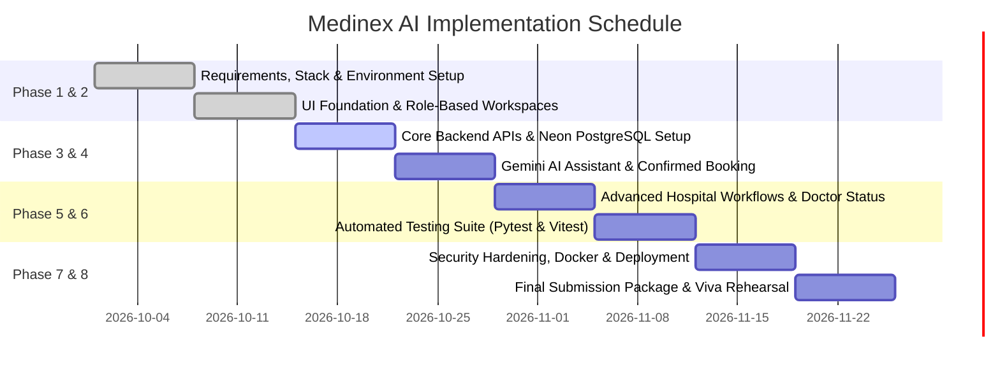

# Medinex AI — AI-Powered Smart Hospital Management System
**Engineering Master Blueprint & Implementation Plan**  
*Final-Year Major Project / Future SaaS Product*  
**Recommended Stack:** React + TypeScript, Python FastAPI, PostgreSQL (Neon), Google Gemini API  
**Last Updated:** October 2026  

---

## 1. Project Vision & Core Modules

Medinex AI is a centralized, role-based smart hospital management and operations platform. It combines automated administrative hospital workflows with an intelligent, database-grounded conversational assistant.

### The 4 Core Modules:
1. **AI Hospital Assistant:** Hinglish, Hindi, and English natural language interface for doctor discovery, live slot lookups, bed & blood queries, and conversational appointment workflows with explicit patient confirmation.
2. **Appointment & Doctor Management:** Doctor profiles, specialties, departments, recurring availability schedules, atomic slot generation, conflict-free booking, cancellation, and status tracking (confirmed, cancelled, completed, no-show).
3. **Hospital Resource Management:** Real-time ward capacity and bed availability tracking, atomic bed admissions/discharge, tested blood bank inventory with expiry checks, and emergency blood request review/fulfillment.
4. **Admin & Doctor Portal:** Role-based workspaces, live operational dashboard, staff & schedule administration, operational analytics, and immutable security audit logs.

---

## 2. Project Scope & Phased Milestones

| Milestone | Deliverables | Status |
| :--- | :--- | :--- |
| **Milestone 1: MVP (P0)** | Secure Auth (Patient/Doctor/Admin), Doctor Discovery & Schedules, Conflict-free Appointments, Ward & Bed Management, Blood Bank & Request Fulfillment, Grounded Gemini Assistant (Read-only + Confirmed Booking). | **In Progress (90% Code Complete, Live Neon DB verification ongoing)** |
| **Milestone 2: Advanced (P1)** | Doctor workflow status management (completed/no-show), Real-time notifications (SSE/WebSocket), Appointment reminders, In-depth operational trend reports, Multi-lingual Hinglish fine-tuning. | **Planned (P1)** |
| **Milestone 3: Future Expansion (P2)** | Multi-hospital tenancy, Digital clinical records & prescriptions, Pharmacy inventory, Queue token management, Predictive no-show analytics. | **Future Scope (P2)** |

*Architecture Rule: Focus strictly on a single-hospital system first with clean domain boundaries, keeping multi-tenant abstractions ready for future expansion without premature complexity.*

---

## 3. Technology Stack

- **Frontend:** React 19, TypeScript, Vite, Tailwind CSS, TanStack Query, React Hook Form, Zod, Motion, Lucide Icons.
- **Backend:** Python 3.13, FastAPI (Modular Monolith), Pydantic v2 Settings & Schemas, Uvicorn.
- **Database:** PostgreSQL (Neon Serverless PostgreSQL), SQLAlchemy 2.0 ORM, Alembic migrations, Psycopg 3 binary driver.
- **AI Integration:** Google Gemini API (`gemini-3.8-flash` via `google-genai` SDK), server-side tool calling with Pydantic schemas.
- **Security:** Argon2 password hashing (`pwdlib[argon2]`), PyJWT for bearer tokens, granular role checks.
- **Testing & Tooling:** Pytest (Backend API & concurrency tests), Vitest + React Testing Library (Frontend UI tests), Docker Compose (Containerization), GitHub Actions (CI/CD pipeline).

---

## 4. System Architecture & Integrity Rules

```
┌─────────────────────────────────────────────────────────────┐
│                       Frontend (React + TS)                 │
│      Patient Portal  │  Doctor Workspace  │  Admin Portal   │
└──────────────────────────────┬──────────────────────────────┘
                               │ HTTPS / JSON REST
┌──────────────────────────────▼──────────────────────────────┐
│                  FastAPI Backend (Modular Monolith)          │
│   Auth & RBAC  │  Input Validation (Zod/Pydantic)  │ CORS    │
├──────────────────────────────┬──────────────────────────────┤
│  Core Services Layer:        │  AI Orchestration Service:   │
│  - Appointments & Schedules  │  - Gemini API Client         │
│  - Beds & Admissions         │  - Function-Calling Tools    │
│  - Blood Bank & Inventory    │  - Safety & Emergency Guard  │
│  - Notifications & Audit     │  - Explicit Confirmation Flow│
└──────────────┬───────────────┴───────────────▲──────────────┘
               │ SQLAlchemy 2.0                │ Tools execute
               ▼                               │ via Services
┌──────────────────────────────────────────────┴──────────────┐
│              PostgreSQL Database (Neon / Local)             │
│    ACID Transactions, Foreign Keys, Exclusions, Constraints │
└─────────────────────────────────────────────────────────────┘
```

### Critical Architecture Rules:
1. **Zero Direct Database Access:** Frontend and external clients never connect directly to the database.
2. **Zero DB Access for Gemini:** The Gemini model receives only structured tool signatures and returns tool call proposals; execution runs exclusively through authenticated backend services.
3. **Atomic Transactions:** Slot booking and blood inventory deductions execute inside single database transactions with row-level locks (`with_for_update`) to prevent race conditions.
4. **Mandatory Patient Confirmation:** AI booking tools never finalize appointments automatically; they generate a pending confirmation summary requiring explicit patient approval.
5. **Verified Hospital Facts:** Displayed values for doctors, slots, beds, and blood always originate from database queries, never generative hallucinations.

---

## 5. Feature Requirements & Priority Matrix

| Module | Feature Description | Priority | Current Status |
| :--- | :--- | :---: | :---: |
| **Auth & Security** | Registration, Login, Role permissions (Patient, Doctor, Admin), Argon2 hashing | **P0** | ✅ Implemented |
| **Patient Portal** | Profile, Doctor Discovery, Slot selection, My Appointments, Cancellation | **P0** | ✅ Implemented |
| **Doctor Management** | Doctor profiles, Specialization/Department filters, Recurring weekly schedules | **P0** | ✅ Implemented |
| **Appointments** | Conflict-free slot booking, Double-booking DB guard, Cancellation audit & notifications | **P0** | ✅ Implemented |
| **Bed Management** | Ward management, Bed creation, Status updates (available, occupied, cleaning, maintenance) | **P0** | ✅ Implemented |
| **Blood Bank** | Blood component batches, Tested status, Expiry checks, Atomic FIFO fulfillment | **P0** | ✅ Implemented |
| **Gemini AI Base** | Grounded hospital queries (search doctors, check slots, check beds, check blood stock) | **P0** | ✅ Implemented |
| **Gemini AI Booking** | Conversational slot lookup with explicit confirmation step before booking execution | **P0** | 🟡 Next Up |
| **Admin Dashboard** | Patient directory, Doctor management, Inventory tracking, Audit logs history | **P0** | ✅ Implemented |
| **Doctor Workspace** | Today's appointment schedule, Patient list, Mark completed/no-show status | **P1** | ⏳ Planned |
| **Notifications** | Private in-app notifications for appointment changes and blood request status | **P1** | ✅ Implemented |
| **Live Updates** | WebSocket or Server-Sent Events (SSE) for real-time inventory/bed refresh | **P1** | ⏳ Planned |
| **Operational Reports** | Aggregated counts, occupancy trends, appointment volume analytics | **P1** | 🟡 Basic Implemented |
| **Bed Admissions** | Formal patient admission and discharge tracking with bed status automation | **P1** | ⏳ Planned |
| **Queue & Tokens** | Token issuance, live queue position, estimated wait times | **P2** | 🔮 Future Scope |
| **Predictive Analytics**| Patient no-show prediction, seasonal blood demand forecasting | **P2** | 🔮 Future Scope |
| **Digital Clinical Records**| Prescriptions, diagnostic lab reports, discharge summaries | **P2** | 🔮 Future Scope |

---

## 6. Database Schema & Integrity Constraints

The schema is defined in `backend/app/models.py` with checked-in Alembic migrations:

### Core Tables:
- `users`: User identity, email, Argon2 password hash, role (`patient`, `doctor`, `admin`, `receptionist`, `nurse`), active flag.
- `patient_profiles`: 1-to-1 with `users`, full name, contact phone number, created timestamp.
- `departments`: Clinical departments (Cardiology, Neurology, Pediatrics, etc.), physical location.
- `doctor_profiles`: 1-to-1 with `users`, department foreign key, specialization, consultation fee, active status.
- `doctor_schedules`: Doctor ID, weekday (0-6), start time, end time, slot duration minutes (default 30 min).
- `appointments`: Patient ID, Doctor ID, start datetime, end datetime, status (`confirmed`, `cancelled`, `completed`, `no_show`).
- `wards`: Ward name, ward type (General, ICU, Maternity, Pediatric, etc.), active flag.
- `beds`: Ward ID, bed number, status (`available`, `reserved`, `occupied`, `cleaning`, `maintenance`).
- `blood_inventory_items`: Blood group (A+, A-, B+, B-, AB+, AB-, O+, O-), component (`red_cells`, `platelets`, `plasma`, `whole_blood`), units count, expiry date, tested flag, status.
- `blood_inventory_transactions`: Audit log of every received, issued, reserved, adjusted, or expired unit change with delta.
- `blood_requests`: Patient ID, requester ID, blood group, component, units requested, urgency (`routine`, `urgent`, `emergency`), review status (`pending`, `approved`, `rejected`, `fulfilled`).
- `notifications`: Recipient user ID, category, title, message, resource reference, read status.
- `audit_logs`: Actor user ID, action name, resource type, resource ID, timestamp.

### Critical Database Constraints:
1. `ck_users_role`: Enforces valid enum roles.
2. `uq_appointments_active_doctor_slot`: PostgreSQL partial unique index on `(doctor_id, start_at) WHERE status <> 'cancelled'` — mathematical guarantee against double-booking.
3. `uq_beds_ward_number`: Unique constraint on `(ward_id, bed_number)` prevents duplicate bed IDs within a ward.
4. `ck_blood_units_nonnegative`: Ensures stock units cannot drop below zero.
5. `ck_blood_requests_group`: Regex check `^(A|B|AB|O)[+-]$` guarantees valid clinical blood groups.

---

## 7. Gemini AI Integration — 4-Stage Operational Flow

```
[ User Prompt (Hindi / Hinglish / English) ]
                     │
                     ▼
  Stage 1: Intent & Entity Understanding (Gemini NLU)
                     │
                     ▼
  Stage 2: Verified Data Retrieval (Server Tools via Backend DB)
           - search_doctors(specialization, department)
           - get_doctor_availability(doctor_id, date)
           - get_bed_availability(ward_type)
           - get_blood_availability(blood_group, component)
                     │
                     ▼
  Stage 3: Patient Confirmation Stage
           Assistant formats exact doctor, date, and slot time.
           Asks: "Kya aap Dr. [Name] ke saath [Date] ko [Time] baje appointment confirm karna chahte hain?"
                     │
                     ▼
  Stage 4: Authenticated Backend Execution
           Patient confirms -> Backend verifies authenticated user token ->
           Executes booking transaction -> Emits Audit Log + Notifications ->
           Returns verified confirmation ID.
```

### Safety & Clinical Guardrails:
- **Emergency Keyword Filter:** Immediate detection of severe symptoms (chest pain, respiratory distress, heavy bleeding, loss of consciousness). Bypasses LLM and provides immediate emergency hotline & nearest trauma center advisory.
- **No Prescriptions or Medical Diagnoses:** System instruction explicitly bars medical diagnosing and drug prescriptions.
- **Idempotency:** AI booking actions use idempotency tokens to prevent duplicate bookings if network retries occur.

---

## 8. Eight-Week Implementation Schedule (Syllabus & Milestone Tracking)



- **Week 1 (Done):** Architecture design, repository setup, React + Vite frontend, FastAPI backend skeleton.
- **Week 2 (Done):** Role-based navigation, Patient/Doctor/Admin portals, mock demo workflows, dark/light theme.
- **Week 3 (Current):** Neon PostgreSQL integration, Alembic migrations, admin bootstrapping, end-to-end API verification.
- **Week 4:** Conversational AI booking flow with two-step patient confirmation, localized Hindi/Hinglish handling.
- **Week 5:** Doctor portal status updates (completed, no-show), bed admissions workflow, operational analytics.
- **Week 6:** Automated test suite (Pytest integration tests, concurrency tests, Zod validation tests).
- **Week 7:** Security hardening (rate limiting, secure error handling), Docker Compose packaging.
- **Week 8:** Cloud deployment, documentation package (SRS, ERD, DFD, API Spec), presentation slides.

---

## 9. Pre-Release Security & Reliability Checklist

- [x] Passwords hashed with Argon2 (`pwdlib[argon2]`); zero plaintext passwords.
- [x] JWT bearer tokens with expiration and role validation on all protected routes.
- [x] Database-level partial unique index prevents appointment slot double-booking.
- [x] Atomic FIFO deductions for blood inventory prevent negative stock levels.
- [x] Immutable security audit logs record all critical administrative actions.
- [ ] Rate limiting on authentication and AI chat endpoints to prevent abuse.
- [ ] Automated concurrency test verifying simultaneous appointment booking collisions.
- [ ] Clean sanitized error responses (no stack traces or internal DB info leaked).
- [ ] Synthetic patient demo seed data script for safe demonstrations.
- [ ] Docker Compose setup for reproducible local and evaluation environments.

---

## 10. Final-Year Academic Submission Package

To satisfy all university/college major project requirements and viva criteria, the project repository includes:

1. **Software Requirements Specification (SRS):** Complete functional & non-functional requirements.
2. **System Architecture Document:** High-level modular monolith diagram and data flow.
3. **Database ER Diagram & Data Dictionary:** Entity relationships, cardinality, and constraint specifications.
4. **Data Flow Diagrams (DFD Levels 0, 1, 2):** Context-level to module-level processes.
5. **REST API Specification:** OpenAPI/Swagger compliant endpoint documentation.
6. **Testing & QA Report:** Pytest test suites covering authentication, concurrent booking, and AI safety benchmarks.
7. **AI Assistant Empirical Research Evaluation:** Quantitative metrics on 150+ synthetic prompts (Intent Accuracy, Resource Retrieval Rate, Task Completion Rate, Hallucination/Unsupported-Claim Rate).
8. **Deployment & Operational Guide:** Step-by-step setup, environment configuration, and rollback guidelines.
9. **Final Presentation Slides & Live Demo Script:** 15-minute viva walkthrough with zero reliance on sample data.
